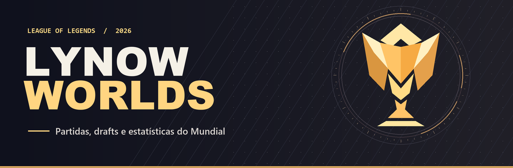
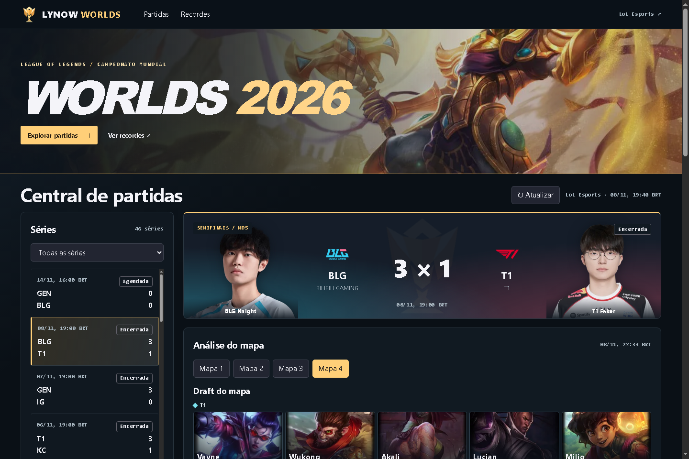

<p align="center"></p>

<p align="center"><b>O Mundial de League of Legends, série por série e mapa por mapa.</b><br>Agenda, draft, ouro, visão e recordes do Worlds 2026 em português.</p>

<p align="center"><a href="https://github.com/arthurlynow098/LynowWorlds/actions/workflows/test.yml"></a> · Node.js 22+ · JavaScript · Interface responsiva</p>

## Rodar no computador

Com Git e Node.js 22 ou superior instalados, execute no terminal:

```sh
git clone https://github.com/arthurlynow098/LynowWorlds.git
cd LynowWorlds
npm start
```

Abra [localhost:3000](http://localhost:3000). O servidor usa a biblioteca padrão do Node. O histórico incluído funciona desde a primeira execução, inclusive quando a fonte da agenda está indisponível. Os escudos das equipes são carregados pela rede.



O draft é interativo. Clique na arte de um campeão para abrir a ficha do jogador naquele mapa, com foto, KDA, dano, ouro e CS. O catálogo desta edição reúne 96 retratos dos elencos do LoL Esports e as artes dos 103 campeões escolhidos. As imagens otimizadas em WebP acompanham o projeto e os endereços de origem estão em [public/media/catalog.json](public/media/catalog.json).

## Explorar o Mundial

1. Filtre as séries por estado. O placar principal mostra os **mapas vencidos na série**, com horário de Brasília e formato do confronto.
2. Selecione um mapa para consultar os campeões, abates, mortes, assistências, dano a campeões, CS, ouro e sentinelas de cada jogador. Compare torres, dragões, barões, inibidores e banimentos por equipe.
3. Leia a curva de ouro a partir do lado azul. Acima de zero, o azul lidera. A maior vantagem considera o valor absoluto da diferença entre os times em cada amostra.
4. Em **Recordes**, veja os líderes acumulados de abates, mortes e assistências, além dos extremos de dano, visão e vantagem de ouro. O painel informa a cobertura usada no cálculo.

## De onde vêm os números

O calendário incluído em 8 de novembro de 2026 tem **46 séries**. O arquivo histórico contém **94 mapas de 45 séries encerradas**. Os placares e os frames finais vêm dos feeds usados pelo [LoL Esports](https://lolesports.com/en-US/leagues/worlds). O dano absoluto, os banimentos e a curva de ouro por minuto foram associados às fichas do [Games of Legends](https://gol.gg/tournament/tournament-matchlist/Worlds%202026%20Main%20Event/). Cada mapa enriquecido tem um link para a ficha original.

Durante uma série, o painel consulta a agenda, os mapas e a telemetria a cada **30 segundos** enquanto a aba está visível. O servidor pede uma janela com cerca de um minuto de atraso para dar tempo à publicação dos frames. A latência efetiva depende da transmissão. A composição aparece quando a fonte publica os campeões. A cobertura ao vivo não inclui a sequência de cada pick e ban durante a seleção. O valor ausente aparece como travessão. Quando a fonte informa apenas a participação no dano da equipe, o painel apresenta o percentual.

Os recordes são calculados sobre o arquivo de mapas encerrados. Durante uma partida, a maior vantagem exibida naquele mapa considera os frames observados pela instância do servidor. Os pontos anteriores à abertura do painel podem estar ausentes. Os arquivos históricos enriquecidos usam amostras por minuto e o encerramento do jogo.

## Como o projeto funciona

| Camada | Responsabilidade |
| --- | --- |
| `public/` | Interface em HTML, CSS e JavaScript. Mantém a seleção ao atualizar e descarta respostas antigas quando o usuário troca de mapa. |
| `server.mjs` | API HTTP local usada pelo navegador e pela função da Vercel. |
| `provider.mjs` | Paginação da agenda, normalização dos eventos e sincronização das estatísticas pelo identificador de participante. |
| `cache.mjs` | Compartilha consultas simultâneas e salva o último resultado válido com escrita atômica. |
| `official.mjs` e `data/` | Histórico, associação das estatísticas complementares e cálculo dos recordes. |
| `test/` | Valida o arquivo de mapas e o comportamento do cache quando a fonte falha. O GitHub Actions roda os testes em Node 22 e 24. |

### API

| GET | Resposta |
| --- | --- |
| `/api/schedule` | Séries, horários, placares, origem e instante da consulta |
| `/api/event/{id}` | Mapas e estado de cada um |
| `/api/game/{id}` | Jogadores, objetivos, série temporal e maior vantagem observada |
| `/api/records` | Cobertura do arquivo e recordes calculados |

### Verificar e atualizar

```sh
npm test
npm run capture
```

O segundo comando consulta a agenda e incorpora mapas encerrados com frame final. Reinicie o servidor depois de atualizar os arquivos. Para acrescentar estatísticas complementares, salve as páginas `page-fullstats` e `page-game` do Games of Legends como `{id}-fullstats.html` e `{id}-game.html` em uma pasta. Instale `beautifulsoup4` em um ambiente Python e execute `python scripts/enrich.py pasta-das-paginas`. O importador só associa uma ficha quando encontra um único mapa correspondente.

Os endpoints usados pelo site de esports podem mudar. O adaptador aceita a variável de ambiente `LOLESPORTS_API_KEY` para atualizar a chave de acesso do cliente de calendário.

## Importar na Vercel

No painel da Vercel, escolha **Add New → Project**, importe **arthurlynow098/LynowWorlds**, mantenha a raiz do repositório e selecione **Deploy**. A configuração versionada serve `public/` e encaminha `/api/*` para a função Node. O arquivo histórico acompanha a publicação. O cache de execução da Vercel é temporário e pode variar entre instâncias.

Projeto independente de fã. League of Legends e as marcas das equipes pertencem a seus respectivos titulares.
